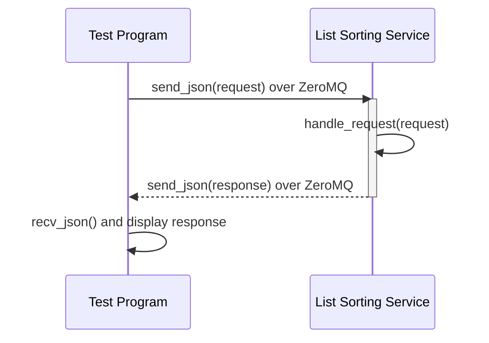

# List Sorting Microservice

## What it does

Sorts a list of objects using a field you choose. You can sort lowest to highest or highest to lowest.

## How to run it

You need Python and `pyzmq` installed. Open a terminal in this folder:

```bash
python -m pip install -r requirements.txt
python microservice.py
```

Leave that running. Open another terminal in the same folder and run:

```bash
python test_client.py
```

## Communication contract

This service uses **ZeroMQ REQ/REP with JSON** on `tcp://127.0.0.1:5551`. The client sends one request and then waits for one reply. Run the server before running the client.

### Requesting data

Use `action`, `items`, `field`, and `order` (`asc` or `desc`). Every item needs the field you want to sort by.

Example JSON request:

```json
{
  "action": "sort",
  "items": [
    {
      "name": "A",
      "score": 9
    },
    {
      "name": "B",
      "score": 2
    }
  ],
  "field": "score",
  "order": "asc"
}
```

Example Python code that **sends the request and receives the reply**:

```python
import zmq

context = zmq.Context()
socket = context.socket(zmq.REQ)
socket.connect("tcp://127.0.0.1:5551")

request = {'action': 'sort', 'items': [{'name': 'A', 'score': 9}, {'name': 'B', 'score': 2}], 'field': 'score', 'order': 'asc'}
socket.send_json(request)

reply = socket.recv_json()
print(reply)

socket.close()
context.term()
```

The client uses `socket.send_json(request)` to send the request. It does not import or call the microservice's functions directly.

### Receiving data

Use `socket.recv_json()` to receive the reply. A successful reply contains `"status": "ok"`. If something is wrong with the request, the reply contains `"status": "error"` and a `"message"` explaining why.

Example successful response:

```json
{
  "status": "ok",
  "items": [
    {
      "name": "B",
      "score": 2
    },
    {
      "name": "A",
      "score": 9
    }
  ]
}
```

To check the response in Python:

```python
reply = socket.recv_json()
if reply["status"] == "ok":
    print(reply)
else:
    print(reply["message"])
```

The example above shows the receive step separately; in a real client, use it **once per request**, as shown in the full example earlier.

## UML sequence diagram



## Files

- `microservice.py`: Runs the server and handles requests.
- `test_client.py`: Sends example requests and prints the replies.
- `requirements.txt`: Lists the Python dependency.
- `sample_requests.json`: Extra example requests.

The server and test client run as separate programs.
